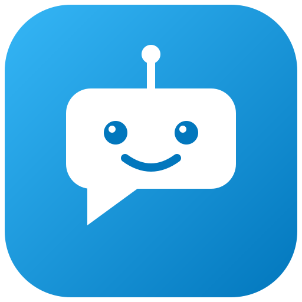

<div align="center">



# Allroggen Support-Chat

**Der Support-Agent für dein Smart Home — direkt in der Home-Assistant-Seitenleiste.**

[](https://hacs.xyz)
[](https://github.com/allroggen/allroggenhasupport/releases)
[](https://www.home-assistant.io)

</div>

---

Sidebar-Chat in Home Assistant, über den Kunden direkt mit dem Support-Agenten
des Allroggen-Ticketsystems schreiben — z. B. *„Erstelle mir ein Dashboard fürs
Obergeschoss"* oder *„Passe die Nachtabsenkung an"*. Der Agent kann dabei live im
Home Assistant des Kunden arbeiten (Automationen, Dashboards, Helfer).

## ✨ Funktionen

| | |
|---|---|
| 💬 **Streaming-Antworten** | Der Agent antwortet Token für Token live (SSE, mit Polling-Fallback) |
| 🏠 **Arbeitet direkt in HA** | Automationen, Dashboards, Helfer und Skripte auf Zuruf |
| 🖼️ **Bild-Upload** | Per 📎-Button Bilder anhängen (clientseitig verkleinert, max. 1600 px). Erfordert ein vision-fähiges Chat-Modell im Ticket-System — der voreingestellte MiniMax-M2 ist reine Text-KI und ignoriert Anhänge |
| 🎤 **Spracheingabe** | Diktieren statt tippen (Web Speech API, Deutsch). Erfordert Chrome oder Edge — in Firefox wird der Button nicht angezeigt |
| ⏹️ **Abbrechen** | Ein laufender Turn lässt sich jederzeit per „Abbrechen"-Button stoppen |
| 🔔 **Ungesehene Antworten** | Roter Zähler am Unterhaltungs-Button und „neu"-Markierung pro Unterhaltung, wenn Antworten oder Rückfragen noch ungelesen sind — auch über Sitzungen hinweg |
| 📊 **Budget & Guthaben im Blick** | Verfügbarer Betrag direkt im Kopf; Monatsbudget, Modell und Tokens unter „Chat-Details“ |
| 📋 **Nachrichten kopieren** | „Kopieren“ übernimmt den Nachrichtentext inklusive Markdown in die Zwischenablage |
| ↪ **Ab hier neu starten** | Erstellt nach Bestätigung einen neuen Chat mit dem Verlauf bis einschließlich der ausgewählten Nachricht. Der Originalchat bleibt erhalten; ausgeführte HA-Aktionen werden nicht rückgängig gemacht |
| 🔎 **Unterhaltungen verwalten** | Suche nach Titel, Umbenennen und Löschen im Unterhaltungsmenü; letzte Frage zum Bearbeiten übernehmen |
| 💶 **Nachkauf auf Rechnung** | Ist alles aufgebraucht, kannst du einmalig deinen vereinbarten Betrag per Knopfdruck auf Rechnung nachbuchen — mit Erklärung und verbindlicher Bestätigung („Kostenpflichtig: X € auf Rechnung nachbuchen"). Bei unklarem Verbindungsresultat wird derselbe Auftrag sicher wiederholt — es wird nie doppelt gekauft |
| 🔒 **Datenschutz** | Das Kunden-Token bleibt serverseitig — es erreicht nie den Browser |

## 📋 Voraussetzungen

- Home Assistant ≥ 2024.8
- Backend-URL und Integrations-Token vom Dienstleister
  (wird im Ticket-System unter *Kunde → Home-Assistant-Chat* erzeugt)

## 🚀 Installation über HACS (empfohlen)

1. HACS → **Integrationen** → ⋮ (Menü) → **Benutzerdefinierte Repositories**
2. `https://github.com/allroggen/allroggenhasupport` als *Integration* hinzufügen
3. **Allroggen Support-Chat** installieren
4. Home Assistant neu starten

<details>
<summary><strong>Manuelle Installation</strong> (ohne HACS)</summary>

1. Den Ordner `custom_components/allroggen_chat` aus diesem Repo nach
   `<config>/custom_components/allroggen_chat` kopieren
2. Home Assistant neu starten

</details>

## ⚙️ Einrichtung

1. **Einstellungen → Geräte & Dienste → Integration hinzufügen** →
   „Allroggen Support-Chat"
2. Backend-Adresse (z. B. `https://ticket.example.com`) und Token eintragen
3. In der Seitenleiste erscheint **Allroggen Support** — fertig 🎉

## 📊 Chat-Kontingent, Guthaben & Nachkauf

Der Chat hat je nach Vereinbarung ein monatliches KI-Budget inklusive
(z. B. 5 € im Basic Plus). Der Guthaben-Button zeigt die Summe aus verbleibendem
Inklusivbudget und gekauftem Guthaben. Unter **Chat-Details (Info-Button)** zeigt der Ring in Prozent,
wie viel davon bereits verbraucht wurde — blau im Normalbereich, orange ab
der Warnschwelle, rot bei Überschreitung. Ohne festes Limit wird kein Ring
angezeigt; auch bei 0 € Inklusivbudget entfällt er. Die Detailansicht zeigt zusätzlich in Euro, wie viel
Inklusbudget diesen Monat übrig ist und wie viel **gekauftes Guthaben** noch
steht.

Wichtige Regeln:

- **Inklusivbudget** gilt pro Monat und wird nicht übertragen — am
  Monatswechsel (Reset-Datum wird angezeigt) steht es frisch zur Verfügung.
- **Gekauftes Guthaben** wird erst *nach* dem Inklusivbudget verbraucht,
  verfällt nicht und bleibt über Monate erhalten.
- Ist beides aufgebraucht, **pausiert nur die KI-Antwort** — Tickets und
  Support laufen ganz normal weiter.

### 💶 Nachkauf auf Rechnung

Über den **Guthaben-Button** oben im Panel öffnet sich die Guthaben-Karte. Ist ein
kundenspezifischer Nachkauf-Betrag für dich hinterlegt und frei gegeben,
führt dich „Nachkauf starten" zur **verbindlichen Bestätigung** — der Button
nennt den Preis ausdrücklich: *„Kostenpflichtig: X € auf Rechnung
nachbuchen"*. Ohne diesen Klick wird nie gebucht.

- Nach Annahme durch die Buchhaltung (ERP) ist das Guthaben **sofort**
  aktiviert; der Betrag wird auf deiner nächsten Rechnung ausgewiesen.
- Der **nächste Nachkauf** ist erst möglich, wenn der vorherige auf einer
  validierten Rechnung erfasst ist; überfällige Rechnungen blockieren den
  Nachkauf. Das Panel zeigt die Gründe verständlich an.
- Fehlt der gültige KI-Guthaben-Serviceartikel im ERP, bleibt der Nachkauf gesperrt:
  **„KI-Guthabenartikel noch nicht eingerichtet. Bitte Support kontaktieren.“**
  Die Einrichtung übernimmt der Dienstleister im ERP, nicht der Browser. Berechtigte manuelle
  ERP-Rechnungen werden nach Validierung beim nächsten Entitlement-Abgleich als Guthaben sichtbar;
  Backend und Panel erzeugen dafür keine zusätzliche Gutschrift.
- Wird die Verbindung während der Buchung unterbrochen, bleibt der Auftrag
  offen: **„Erneut senden" wiederholt denselben Auftrag** (gleiche
  Anfrage-ID) — das Backend bucht garantiert nichts doppelt. Erst nach
  eindeutigem Abschluss erhält ein späterer Kauf eine neue Anfrage-ID.

Die Chat-Details zeigen außerdem die Tokensumme der geöffneten Unterhaltung.
Unterhaltungen lassen sich in der einklappbaren Seitenleiste suchen und wechseln.
Das Menü neben dem Unterhaltungstitel bietet Umbenennen, Löschen und „Letzte Frage
bearbeiten“. Umbenennen und „Ab hier neu starten“ benötigen die entsprechenden
neuen Backend-Endpunkte; Kopieren funktioniert auch mit älteren Backends
(Zwischenablage erfordert HTTPS oder localhost und Browser-Berechtigung).

Bei Versandfehlern bleibt der Text als Entwurf erhalten. Ist der Versandstatus
unklar, zuerst **Verlauf prüfen**: Die Nachricht könnte bereits angenommen worden
sein. Das Panel sendet nie automatisch erneut. „Ab hier neu starten“ kopiert
den Verlauf einschließlich Bildreferenzen, ruft aber keine KI oder HA-Werkzeuge
auf und kopiert keine alten Kostenbuchungen. Spätere Antworten nutzen den kopierten
Verlauf als Kontext und können dadurch erneut Kontextkosten verursachen.

## 🛠️ Fehlerbehebung

| Problem | Lösung |
|---|---|
| „Backend nicht erreichbar" beim Einrichten | URL prüfen (https, kein abschließender `/`), Backend/Proxy erreichbar? |
| „Token ungültig" | Token im Ticket-System prüfen (widerrufen/abgelaufen?) und ggf. neu ausstellen lassen, dann in den Integrationseinstellungen das neue Token eintragen |
| „Chat ist nicht eingerichtet" im Panel | Für den Kunden ist kein Chat-Agent hinterlegt — Dienstleister kontaktieren |
| Panel fehlt nach Update | Browser-Cache leeren / harte Aktualisierung (Strg+F5) |
| `ALL_TARGETS_SKIPPED` / KI-Dienst nicht verfügbar | Im KI-Router wurden alle Ziele ausgeschlossen. Dienstleister prüft Modellroute, Anbieter-Limits und Sperrzeiten. Kundenguthaben ist davon getrennt; technische Details und Zeitpunkt angeben. |

## 🔑 Token erneuern (Reauth)

Läuft das Integrations-Token ab oder wird es widerrufen, meldet die Integration
automatisch **„Erneute Authentifizierung erforderlich"**. Dort das neue Token
eintragen — die Integration lädt sich danach selbst neu, Einrichtung und
Unterhaltungen bleiben erhalten.

## 🧑‍💻 Entwicklung

Architektur-Grundprinzipien:

- `proxy.py` leitet `/api/allroggen_chat/*` mit `X-Customer-Token` an
  `<backend>/api/customer-chat/*` weiter — Token bleibt serverseitig, kein
  CORS-Problem. Bei 401 vom Backend startet die Integration automatisch den
  Reauth-Flow. Der Pfad `/stream` (SSE) wird nicht gepuffert, sondern Chunk
  für Chunk durchgereicht. Der Pfad `/topup` (KI-Guthaben-Nachkauf) bekommt
  einen längeren Timeout, weil das Backend die Buchung serverseitig über
  das ERP (Rechnung) abwickelt, bevor es antwortet.
- `panel/allroggen-chat-panel.js` ist eine dependency-freie Webcomponent,
  die per `fetch` mit dem HA-Access-Token gegen die Proxy-View arbeitet.
  Realtime läuft über **SSE (Token-Streaming)**: Das Panel hält einen
  persistenten Stream auf `/stream` (EventSource kann keinen
  Authorization-Header senden, daher fetch-basiertes Frame-Parsing) und
  rendert Antwort-Token live in eine Entwurfs-Blase. Backends ohne
  Stream-Endpoint (404) oder Stream-Fehler fallen automatisch auf Polling
  zurück (alle 3 s nach dem Senden, 5 min Timeout); dieser historische Abgleich
  läuft auch mit SSE als Schutz gegen verpasste Abschlussereignisse. Der Stream wird mit
  Backoff (5 s → max. 60 s) erneut versucht.

### 🧪 Tests

```bash
pip install -r requirements_test.txt
pytest tests/            # Proxy/Setup (Python)
node tests/test_panel_logic.mjs   # Guthaben-/Nachkauf-Logik des Panels (JS)
node tests/test_panel_recovery.mjs # einschließlich Versand-/Streaming-/Aktionsregressionen
```

Für eine lokale UI-Prüfung mit synthetischen Daten: `python3 -m http.server 8766`
und `http://localhost:8766/tests/panel-preview.html` öffnen. Keine echte HA-Verbindung nötig.
